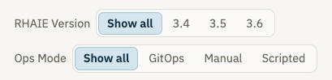
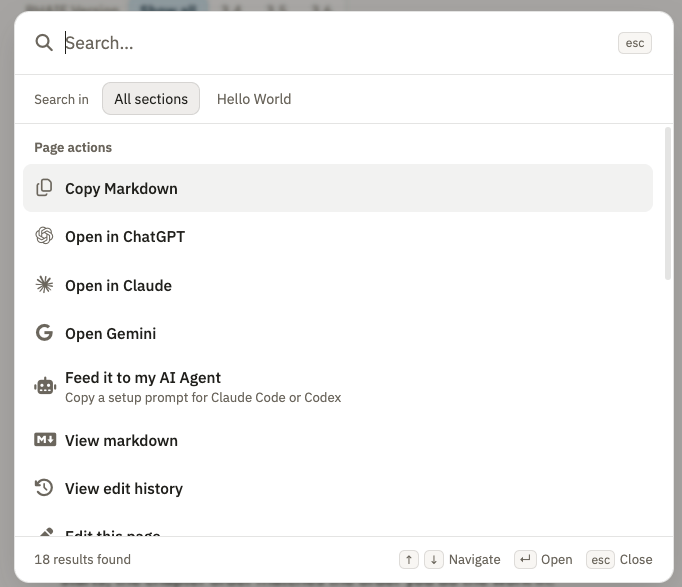

Two controls shape every manual page: the variant selector that filters content to your version and workflow, and the command palette for search and AI hand-off. This page tours both with screenshots.

## The variant selector

At the top of every manual page, directly above the first heading, the selector offers one row per filter:

- **RHAIE Version**: `Show all` · `3.4` · `3.5` · `3.6`
- **Ops Mode**: `Show all` · `GitOps` · `Manual` · `Scripted`

Click a pill to filter the page to that version or mode. Click `Show all` on a row to see every version or mode side by side. On a first visit the selector starts at RHAIE Version **3.6** and Ops Mode **Show all**, so 3.4 and 3.5 notes stay hidden until you change it. What each option filters and where your choices are remembered is covered on [Customize this!]().

Search and every quick action live in one overlay, the command palette:

What you are looking at:

- The header is a live `Search…` input.
- Under it, **Search in** toggles the scope: `All sections` (the whole site) vs. the current manual (`Hello World` on this page).
- Below that, the **Page actions** group lists quick actions for the page you are on. The menu next to the page title offers the same actions; the palette is the keyboard route to them.

### How to open it

- **Click** the `Search…` box in the top bar or the magnifying-glass button in the sidebar.
- **Press ⌘K / Ctrl+K** to toggle the palette open or closed.
- **Press /** to open straight into full search.
- **Press \\** to open straight into the command list (same as typing `>`).
- **Press Esc** to close and return focus to where you were.

Once open, type to filter pages and actions, use <kbd>↑</kbd>/<kbd>↓</kbd> to move, <kbd>↵</kbd> to open, and prefix your query with `>` to show only commands.

You can also reach the same actions without the palette: click the disclosure caret `▾` next to the page title to open the page menu.

### Using the AI actions

The rows under **Page actions** take the current page elsewhere, usually to your AI assistant:

| Row | What it does |
|---|---|
| **Open in ChatGPT** | Opens ChatGPT in a new tab with a prompt pointing at this page ("Read from <page URL> so I can ask questions about it"). The content itself is not fetched; you hand the AI the URL. |
| **Open in Claude** | Same prompt pointing at this page, for Claude. |
| **Open Gemini** | Opens the Gemini app in a new tab. It does not pre-fill a prompt like the other two; paste the page URL yourself. |
| **Feed it to my AI Agent** | Opens a dialog with a ready-to-copy setup prompt for Claude Code or Codex (see below). |
| **View markdown** | Opens the raw markdown for this page in a new tab. |
| **View edit history** | Opens the GitHub history for this page. |

#### The copy-prompt dialog

Choosing **Feed it to my AI Agent** opens a dialog titled *Feed this to your AI Agent* with a single `Copy prompt` button:

- The prompt tells your agent to clone this repository, follow the setup steps in the README, survey the manuals, and report what the manual can do, then ask you what to do next.
- Click **Copy prompt** to copy it, then paste it into Claude Code or Codex. The label briefly flips to `Copied` to confirm.
- Close the dialog with `×`, by clicking outside it, or with <kbd>esc</kbd>.

Both screenshots come from this page. The selector was captured with both filters set to `Show all` for clarity; a first visit shows a narrower page, as described above. The palette was captured with an empty query. Your choices are saved in the browser and persist across pages, so what the page hides follows you around the site.
